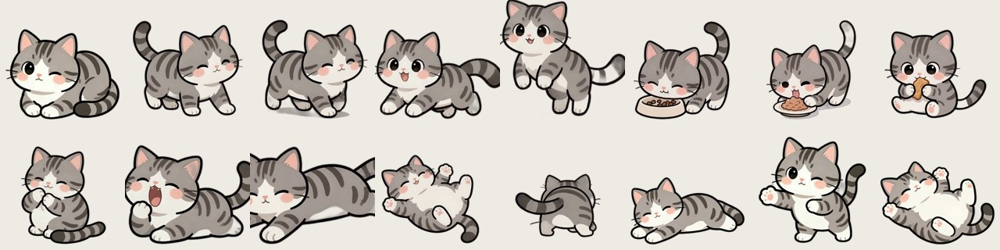
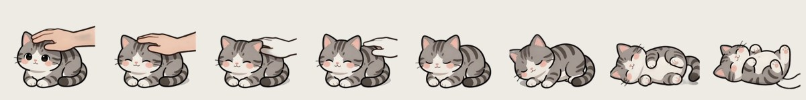

# 猫咪桌宠 my-cat-desktop-pet

一只由自家美短猫的照片与 AI 动作视频制作的 Windows 桌面宠物：会在桌面上散步、睡觉、洗脸、吃饭，掉下来会弹跳，还能和你聊天。



## 效果演示

**摸摸头**（真的有手在撸）：


**吃罐罐**：


**打滚**：


**转圈圈**：


**兴奋跑**：


## 功能

- **自由活动**：走走停停地散步，偶尔停下来洗脸、转圈圈，走累了自己歇着
- **生活动作**：睡觉、打哈欠、伸懒腰、打滚、洗脸、突然兴奋跑、转圈圈，全部逐帧动画
- **互动**：右键摸摸头、喂食三连、"做动作"菜单可点播任意动作
- **物理**：拎起来会挣扎，松手四脚天下掉落——翻滚下坠、落地弹
- **聊天**：双击猫咪打开对话框，内置猫语语录闲聊；配置任意 OpenAI 兼容接口后由大模型扮演你的猫
- **问候**：每隔几分钟冒气泡和你打招呼，早/中/晚文案不同



## 运行

环境：Windows 10/11 + Python 3.10+，安装依赖：

```bash
pip install PyQt5 pillow
```

双击 `启动猫咪.bat`，或：

```bash
python pet.py
```

托盘猫图标右键可显示/隐藏、退出；程序自带单实例保护，重复启动会自动退出。

## 自定义

| 想改什么 | 怎么改 |
|---|---|
| 猫的名字 | `catcfg.json` 的 `name`，以及 `data/v2/petconfig.ini` 的 `petname` |
| 猫的大小 / 走路速度 | `data/v2/petconfig.ini` 的 `petscale` / `petspeed` |
| 各动作出现频率 | `petconfig.ini` 的 `standactionrate`（对应 standaction 列表）|
| 接入大模型聊天 | `catcfg.json` 填 `base_url` / `api_key` / `model`（任意 OpenAI 兼容接口）|

改完右键猫咪 → 重启生效。

## 开机自启

`Win+R` → `shell:startup` → 把 `启动猫咪.bat` 的快捷方式放进去。

## 致谢与声明

- 桌宠引擎基于开源项目 [WolfChen1996/DesktopPet](https://github.com/WolfChen1996/DesktopPet)（刀刀的猫猫）二次开发，感谢原作者！
- 原项目未附带开源许可证，本仓库仅供个人学习交流，**请勿商用**；猫的形象素材基于本人宠物照片与 AI 生成内容制作。
